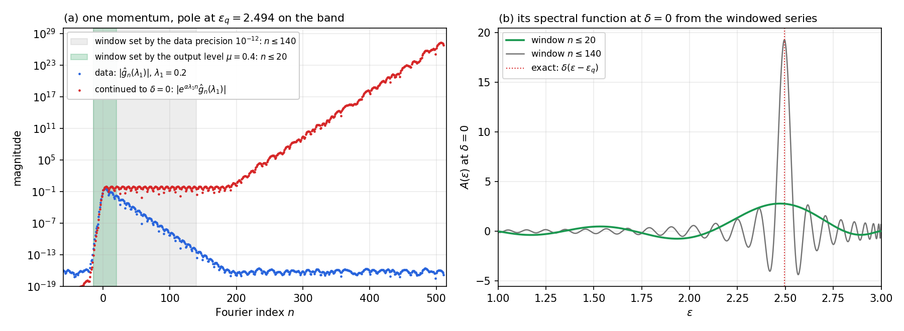
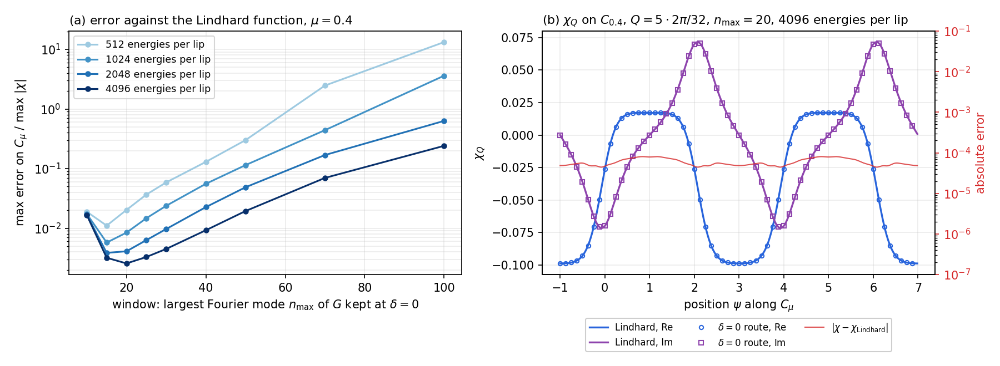

# The bubble through the real axis: continuing $G$ to $\delta\to0$ with a window

$G_q$ is known on a dumbbell contour around its band. The idea is to continue it down to the real axis (level $\delta\to0$), compute the bubble there as a convolution in energy, and continue the bubble back up to its own dumbbell. To make the convolution an index shift, $G$ is sampled at equally spaced energies, which on the dumbbell means a warped grid built from the incomplete elliptic integral $F$.

For the test model $G_q(z)=1/(z-3\cos q)$ the continuation to $\delta=0$ has no exact result: $G$ there is a distribution. A window makes it a function and the route then works approximately. Compared with the Lindhard function on the dumbbell of $\chi$ at level $\mu=0.4$, the best error is $2\times10^{-3}$ of $\max\lvert\chi\rvert$, and it does not go to zero. This note describes the setup, the steps, why the continuation blows up, the two windows that are needed, and the results.

## 1. Model and bubble

- Band: $\varepsilon_q=3\cos q$ on $N_q=32$ momenta $q=2\pi m/32$; the band is $[-3,3]$.
- Green function: $G_q(z)=1/(z-\varepsilon_q)$, with spectral function $A_q(\varepsilon)=\delta(\varepsilon-\varepsilon_q)$.
- Temperature: $\beta=\pi$; Fermi function $f(z)=1/(e^{\beta z}+1)$.
- Bubble (no minus sign, momentum average): $\chi_Q(i\nu_m)=\frac1{N_q}\sum_q\frac1\beta\sum_nG_q(i\omega_n)\,G_{q+Q}(i\omega_n+i\nu_m)$.
- Reference: the Lindhard function, the continuation of $\chi_Q$ to any $w\notin\mathbb R$,

$$
\chi^{\rm L}_Q(w)=\frac1{N_q}\sum_q\frac{f(\varepsilon_q)-f(\varepsilon_{q+Q})}{w+\varepsilon_q-\varepsilon_{q+Q}} .
$$

For $\mathrm{Im}\,w\neq0$ the bubble is a contour integral,

$$
\chi_Q(w)=\frac1{N_q}\sum_q\frac1{2\pi i}\oint_Cdz\;f(z)\,G_q(z)\Big[G_{q+Q}(z+w)+G_{q-Q}(z-w)\Big],
$$

with $C$ a counterclockwise contour around $[-3,3]$ that leaves out the poles of $f$ and the shifted cuts $[-3,3]\mp w$. Collapsing $C$ onto the band, where $G_q(\varepsilon-i0)-G_q(\varepsilon+i0)=2\pi i\,A_q(\varepsilon)$, gives

$$
\chi_Q(w)=\frac1{N_q}\sum_q\int d\varepsilon\,f(\varepsilon)\,A_q(\varepsilon)\Big[G_{q+Q}(\varepsilon+w)+G_{q-Q}(\varepsilon-w)\Big],
$$

and at $w=\Omega\pm i0$ the retarded and advanced bubbles on the real axis,

$$
\chi^R_Q(\Omega)=\frac1{N_q}\sum_q\int d\varepsilon\,fA_q\Big[G^R_{q+Q}(\varepsilon+\Omega)+G^A_{q-Q}(\varepsilon-\Omega)\Big],\qquad
\chi^A_Q(\Omega)=\frac1{N_q}\sum_q\int d\varepsilon\,fA_q\Big[G^A_{q+Q}(\varepsilon+\Omega)+G^R_{q-Q}(\varepsilon-\Omega)\Big].
$$

This is the convolution the route computes. Inserting $A_q=\delta(\varepsilon-\varepsilon_q)$ gives back the Lindhard function.

## 2. The dumbbells

**The map.** With $\kappa=3/\sqrt{10}$, $K=K(\kappa)=2.5781$, $K'=K(\kappa')=1.6124$ (complete elliptic integrals, parameter $\kappa^2=0.9$) and the Jacobi function $\mathrm{sd}=\mathrm{sn}/\mathrm{dn}$,

$$
\omega(\zeta)=\kappa\,\mathrm{sd}\Big(\tfrac K2(\zeta+1)\,\Big|\,\kappa^2\Big),\qquad\zeta=\phi+i\tau\lambda,\qquad\tau=\frac{2K'}K=1.2509,\qquad\alpha=\frac{\pi\tau}4=0.9824 .
$$

$\phi$ is the position along a contour (period 8) and $\lambda$ its level. For $0<\lambda<1$, $\phi\mapsto\omega(\phi+i\tau\lambda)$, $\phi\in[-1,7)$, traces a closed curve $C_\lambda$ around the band, clockwise in $\phi$.

- At $\lambda\to0$ the contour collapses onto the band. The upper lip, $\phi\in(-3,1)$ (modulo 8), gives $G(\varepsilon+i0)=G^R$; the lower lip, $\phi\in(1,5)$, gives $G(\varepsilon-i0)=G^A$. The tips are $\phi=1$ ($\varepsilon=3$) and $\phi=5$ ($\varepsilon=-3$).
- At $\lambda=1$ the contour is the pair of rays $\lvert\mathrm{Im}\,z\rvert\ge1$ on the imaginary axis. The poles $i(2n+1)$ of $f$ lie there for $\beta=\pi$, so every $C_\lambda$ with $0<\lambda<1$ separates the band from them.
- Real energies outside the band lie on the tip lines $\phi=1$ ($\varepsilon>3$) and $\phi=5$ ($\varepsilon<-3$), at a level $0<\lambda<1$ that goes to 0 at the band edges.

**The dumbbell of $\chi$.** The bubble has its cut on $[-6,6]$ and the bosonic frequencies at $\lvert\mathrm{Im}\,w\rvert\ge2$, twice those of $G$, so its contour at level $\mu$ is the doubled map $w=2\,\omega(\psi+i\tau\mu)$, with position $\psi$. At level 0 it gives the real frequencies $\Omega=2\,\omega_0(\psi)\in[-6,6]$, with $\chi^R$ on the upper lip and $\chi^A$ on the lower lip.

**Fourier modes and the level multiplier.** On the $N$ uniform nodes $\phi_j=-1+8j/N$ of $C_\lambda$,

$$
\widehat g_n(\lambda)=\frac1N\sum_{j=0}^{N-1}G\big(\omega(\phi_j+i\tau\lambda)\big)\,e^{-i\pi n\phi_j/4},\qquad
G\big(\omega(\phi+i\tau\lambda)\big)=\sum_n\widehat g_n(\lambda)\,e^{i\pi n\phi/4}.
$$

$G(\omega(\zeta))$ is 8-periodic in $\phi$ and analytic in the strip $0<\lambda<2$, so shifting the line of integration of the Fourier integral from level $\lambda_0$ to level $\lambda$ gives

$$
\widehat g_n(\lambda)=e^{-\alpha(\lambda-\lambda_0)n}\,\widehat g_n(\lambda_0).
$$

Changing the level is diagonal in the Fourier modes. Going up damps the modes $n>0$; going down multiplies them by $e^{\alpha(\lambda_0-\lambda)n}$, which grows without bound. The coefficients at level $\lambda$ decay at most like $e^{-\alpha\lambda n}$ for $n>0$ (the band at level 0) and like $e^{-\alpha(2-\lambda)\lvert n\rvert}$ for $n<0$ (its image at level 2).

**Coordinates of a point.** Every $s\in\mathbb C\setminus[-3,3]$ is $\omega(\zeta)$ for exactly one $\zeta=\mathscr Z(s)$ with $\phi\in[-1,7)$ and $0<\lambda\le1$. In closed form, $\mathscr Z_0(s)=\frac2K\,F\big(\arcsin\frac{s}{\kappa\sqrt{1+s^2}}\,\big|\,\kappa^2\big)-1$, with $F$ the incomplete elliptic integral of the first kind, reduced to that domain. $G$ at $s$ follows from the coefficients at level $\lambda_1$:

$$
G(s)=\sum_n\widehat g_n(\lambda_1)\,e^{i\pi n(\mathscr Z(s)-i\tau\lambda_1)/4}.
$$

## 3. The warp: equally spaced energies at $\delta=0$

On a uniform $\phi$ grid the energies $\omega_0(\phi_j)$ cluster at the band edges like Chebyshev nodes, and $\varepsilon\to\varepsilon+\Omega$ is not an index shift. The warp fixes this at $\delta=0$. The upper lip of the band, $\varepsilon=\omega_0(\phi)$ for $\phi\in(-3,1)$, has the closed-form inverse

$$
\phi_{\rm up}(x)=-1+\frac2K\,F\Big(\arcsin\frac{x}{\kappa\sqrt{1+x^2}}\,\Big|\,\kappa^2\Big),\qquad x\in[-3,3],
$$

the nonlinear function of the warp. Take the energies equally spaced,

$$
\varepsilon_j=-3+\big(j+\tfrac12\big)\Delta\varepsilon,\qquad\Delta\varepsilon=\frac6{N_e},\qquad j=0,\ldots,N_e-1,
$$

with $N_e$ energies per lip, at $\phi=\phi_{\rm up}(\varepsilon_j)$ on the upper lip and $\phi=2-\phi_{\rm up}(\varepsilon_j)$ on the lower lip. In $\phi$ these nodes are not uniform; they are sparse near the tips, where $\phi$ behaves like the square root of the distance to the edge. With $\Omega_m=m\,\Delta\varepsilon$ the shift $\varepsilon_j\to\varepsilon_j+\Omega_m$ is the index shift $j\to j+m$, which in a quantics tensor train is the adder, of bond dimension 2. The grid is extended with the same spacing to $[-9,9]$, because the shifted arguments $\varepsilon\pm\Omega$ reach $\lvert9\rvert$; those energies outside the band lie on the tip lines.

The index shift is exact only at $\delta=0$. At a finite level $\delta$ the nodes $\omega(\phi_{\rm up}(\varepsilon_j)+i\tau\delta)$ do not form an arithmetic progression in the complex plane, so moving by $m$ indices is not a shift by a fixed complex frequency. This is why the route goes all the way to $\delta=0$.

## 4. The setup of the test

- Data: $G_q$ at the $N=2048$ uniform nodes of $C_{\lambda_1}$, with $\lambda_1=0.2$ unless stated otherwise.
- Real axis: $N_e=512$ to 8192 energies per lip.
- Output: $\chi_Q$ at the 512 points $w_k=2\,\omega(\psi_k+i\tau\mu)$ of $C_\mu$, $\psi_k=-1+8k/512$, with $\mu=0.4$ unless stated otherwise; transfer momenta $Q=5\cdot2\pi/32$ and $Q=\pi$.
- Error: $\max_k\lvert\chi_Q(w_k)-\chi^{\rm L}_Q(w_k)\rvert/\max_k\lvert\chi^{\rm L}_Q(w_k)\rvert$, the larger of the two $Q$.

## 5. The six steps

1. **Coefficients of the data**, by FFT: $\widehat g_{q,n}(\lambda_1)=\frac1N\sum_jG_q\big(\omega(\phi_j+i\tau\lambda_1)\big)\,e^{-i\pi n\phi_j/4}$.
2. **Continuation to $\delta=0$ with a window:** $a_{q,n}=W_n\,e^{\alpha\lambda_1n}\,\widehat g_{q,n}(\lambda_1)$, the coefficients at level 0 restricted to the window $W_n$ (Secs. 6 and 7).
3. **$G$ at $\delta=0$ on the equal-energy grid.** In the band,

   $$
   G^R_q(\varepsilon_j)=\sum_na_{q,n}\,e^{i\pi n\,\phi_{\rm up}(\varepsilon_j)/4},\qquad
   G^A_q(\varepsilon_j)=\sum_na_{q,n}\,e^{i\pi n\,(2-\phi_{\rm up}(\varepsilon_j))/4},\qquad
   A_q(\varepsilon_j)=\frac{G^A_q(\varepsilon_j)-G^R_q(\varepsilon_j)}{2\pi i}.
   $$

   Outside the band $G^R=G^A=G$, from the same windowed series at the tip-line points: $G_q(\varepsilon)=\sum_nW_n\,\widehat g_{q,n}(\lambda_1)\,e^{i\pi n(\mathscr Z(\varepsilon)-i\tau\lambda_1)/4}$. These levels go down to 0.039 at the first energy outside the band for $N_e=512$.
4. **The bubble on the real axis**, the convolution of Sec. 1 on the equal-energy grid, with both shifts as index shifts:

   $$
   \chi^R_Q(\Omega_m)=\frac{\Delta\varepsilon}{N_q}\sum_q\sum_{j=0}^{N_e-1}f(\varepsilon_j)\,A_q(\varepsilon_j)\Big[G^R_{q+Q}(\varepsilon_{j+m})+G^A_{q-Q}(\varepsilon_{j-m})\Big],\qquad\lvert m\rvert\le N_e,
   $$

   and $\chi^A_Q(\Omega_m)$ with $R$ and $A$ exchanged in the bracket. This covers $\Omega\in[-6,6]$.
5. **Fourier coefficients of $\chi$ on its own dumbbell.** At level 0, $\chi^R_Q(\Omega_m)$ sits at $\psi=\phi_{\rm up}(\Omega_m/2)$ on the upper lip and $\chi^A_Q(\Omega_m)$ at $\psi=2-\phi_{\rm up}(\Omega_m/2)$ on the lower lip: the same warp, for the doubled map. A periodic cubic spline in $\psi$ through both lips gives $\chi$ on a uniform $\psi$ grid of 16384 points, and the FFT gives $\widehat c_n(0)$. The spline is taken in $\psi$ because there $\chi$ is smooth through the tips, while as a function of $\Omega$ it has a square root at $\pm6$.
6. **Up to level $\mu$ and synthesis:** $\widehat c_n(\mu)=e^{-\alpha\mu n}\,\widehat c_n(0)$ on the window $-n^\chi_{\rm neg}\le n\le n^\chi_{\max}$ of Sec. 7, then $\chi_Q(w_k)=\sum_n\widehat c_n(\mu)\,e^{i\pi n\psi_k/4}$, compared with $\chi^{\rm L}_Q(w_k)$.

## 6. Why the continuation to $\delta=0$ blows up, and the window on $G$

Figure 1(a) shows one momentum ($\varepsilon_q=2.494$, $\lambda_1=0.2$): the data coefficients and the same coefficients continued to $\delta=0$, i.e. multiplied by $e^{\alpha\lambda_1n}$. Two different things make the continuation blow up.

**The noise.** The data coefficients fall like $e^{-\alpha\lambda_1n}$ until they reach the rounding level of the FFT, $10^{-16}$, at $n\approx180$. Beyond that the continuation multiplies noise by $e^{\alpha\lambda_1n}$: the continued coefficients reach $3\times10^5$ at $n=250$, $3\times10^9$ at $n=300$ and $6\times10^{26}$ at $n=511$. Without a window this noise dominates every value at $\delta=0$.

**The target.** Below $n\approx180$ the continued coefficients are clean, and they do not decay: they oscillate between about 0.01 and 0.9. They agree with the coefficients computed directly at the levels $0.02$ and $0.05$ and continued in the same way, so they are the exact coefficients at $\delta=0$. They do not decay because the pole of $G_q$ is on the band. At $\delta=0$, $G^R_q(\varepsilon)=\mathrm P\frac1{\varepsilon-\varepsilon_q}-i\pi\,\delta(\varepsilon-\varepsilon_q)$ is a distribution, and its Fourier series does not converge to a function. Noiseless data would not change this.

*Figure 1.* (a) Coefficients of one momentum ($\varepsilon_q=2.494$) at $\lambda_1=0.2$ (blue) and continued to $\delta=0$ (red). Grey: the window set by the data precision $10^{-12}$ ($n\le140$). Green: the window set by the output level $\mu=0.4$ ($n\le20$). (b) The spectral function of the same momentum at $\delta=0$ from the windowed series, for the two windows. The exact result is $\delta(\varepsilon-\varepsilon_q)$.

**What the window does.** The window is a 0/1 mask on the modes, $W_n=1$ for $-n_{\rm neg}\le n\le n_{\max}$ and 0 otherwise. It does two jobs at $\delta=0$. It removes the amplified noise, and it turns the distribution into a function: the windowed series is the boundary value of $G$ convolved with the kernel of the window, i.e. $G$ broadened over about $8/n_{\max}$ in $\phi$. For the 0/1 mask the kernel is a Dirichlet kernel, with oscillating side lobes.

**Two choices of $n_{\max}$.**

- *Set by the data precision.* Keep the modes whose data are above the precision $\mathrm{tol}$: $n_{\max}=\lfloor\ln(1/\mathrm{tol})/(\alpha\lambda_1)\rfloor$, $n_{\rm neg}=\lfloor\ln(1/\mathrm{tol})/(\alpha(2-\lambda_1))\rfloor$. For $\lambda_1=0.2$ and $\mathrm{tol}=10^{-12}$ this is $-15\le n\le140$. It is the right choice for a continuation to a level $\delta>0$, where the exact coefficients decay. At $\delta=0$ it leaves $G$ too sharp: the spectral function in Fig. 1(b) is a peak of height 19 with side lobes down to $-4$, narrower than the energy grid can follow.
- *Set by the output level.* At $\mu=0.4$ only the modes up to $n_{\max}\approx15$ to 20 matter (Sec. 8). With $n_{\max}=20$ the spectral function is a broad bump (Fig. 1(b)).

The data level $\lambda_1$ itself does not matter, as long as the window lies inside the clean range of the data.

## 7. The second window, on the way up

Going from level 0 up to $\mu$ multiplies mode $n$ of $\chi$ by $e^{-\alpha\mu n}$. This damps the positive modes but amplifies the negative ones by $e^{\alpha\mu\lvert n\rvert}$. For the exact $\chi$ the amplification is harmless, because its negative modes decay like $e^{-2\alpha\lvert n\rvert}$ at level 0. The errors of $\chi$ at level 0 do not decay, so the negative modes must be cut where the true ones fall below the errors. With $n_{\max}=20$ and 2048 energies per lip:

| negative $\chi$ modes kept | $n\ge0$ | $n\ge-2$ | $n\ge-5$ | $n\ge-8$ |
|---|---|---|---|---|
| error | $6.2\times10^{-2}$ | $4.1\times10^{-3}$ | $6.3\times10^{-3}$ | $3.5\times10^{-2}$ |

With $n\ge0$ the true mode $n=-2$ is lost; beyond $n=-2$ the amplified errors take over. The odd modes vanish for this even band, since $\chi_Q(-w)=\chi_Q(w)$, so $n=-1$ changes nothing. The results below keep $n\ge-2$, and the positive modes up to $n^\chi_{\max}=70$, beyond which $e^{-\alpha\mu n}<10^{-12}$. With both windows set by the data precision $10^{-12}$ ($n\le140$ on $G$, 14 negative modes on $\chi$) and 512 energies per lip, the error is $1.8\times10^3$.

## 8. Results

Error for $\mu=0.4$, $\lambda_1=0.2$, the 0/1 window on $G$ and $n\ge-2$ on $\chi$, against $n_{\max}$ and the number of energies per lip $N_e$:

| $n_{\max}$ | $N_e=512$ | 1024 | 2048 | 4096 | 8192 |
|---|---|---|---|---|---|
| 10 | $1.9\times10^{-2}$ | $1.7\times10^{-2}$ | $1.7\times10^{-2}$ | $1.7\times10^{-2}$ | |
| 15 | $1.1\times10^{-2}$ | $5.7\times10^{-3}$ | $3.9\times10^{-3}$ | $3.2\times10^{-3}$ | $3.0\times10^{-3}$ |
| 20 | $2.0\times10^{-2}$ | $8.4\times10^{-3}$ | $4.1\times10^{-3}$ | $2.6\times10^{-3}$ | $2.0\times10^{-3}$ |
| 25 | $3.7\times10^{-2}$ | $1.5\times10^{-2}$ | $6.3\times10^{-3}$ | $3.3\times10^{-3}$ | $2.2\times10^{-3}$ |
| 30 | $5.9\times10^{-2}$ | $2.4\times10^{-2}$ | $9.7\times10^{-3}$ | $4.5\times10^{-3}$ | $2.6\times10^{-3}$ |
| 40 | 0.13 | $5.6\times10^{-2}$ | $2.3\times10^{-2}$ | $9.3\times10^{-3}$ | |
| 50 | 0.30 | 0.11 | $4.9\times10^{-2}$ | $1.9\times10^{-2}$ | |
| 70 | 2.5 | 0.44 | 0.17 | $7.0\times10^{-2}$ | |
| 100 | 13 | 3.6 | 0.63 | 0.24 | |
| 140 (data precision) | 26 | | | | |

The window trades two errors against each other, so the error is not monotonic in $n_{\max}$.

- With too few modes the error comes from the modes of $G$ that the window drops: with $n_{\max}=10$ it stays at $1.7\times10^{-2}$ whatever $N_e$.
- With too many, $G$ at $\delta=0$ is too sharp for the energy grid. The error grows with $n_{\max}$, and at fixed $n_{\max}$ it falls about as $1/N_e$.
- The best value is $2.0\times10^{-3}$, at $n_{\max}=20$ with 8192 energies per lip. With $n_{\max}=15$ the error stops at $3.0\times10^{-3}$. Recovering the dropped modes needs a larger window, and a larger window needs a proportionally finer energy grid, so the error does not go to zero.

Other parameters, at 2048 energies per lip:

- The data level: $\lambda_1=0.2$, 0.3 and 0.5 give the same $4.1\times10^{-3}$ at $n_{\max}=20$.
- The output level (best among $n_{\max}=10$, 15, 20, 30, 40, 60):

  | $\mu$ | 0.2 | 0.4 | 0.8 |
  |---|---|---|---|
  | best $n_{\max}$ | 30 | 15 | 10 |
  | error | $5.0\times10^{-3}$ | $3.9\times10^{-3}$ | $1.1\times10^{-2}$ |

  The best window shrinks as $\mu$ grows. At $\mu=0.8$ the kept mode $n=-2$ is amplified by $e^{2\alpha\mu}=4.8$ instead of 2.2, and $\max\lvert\chi\rvert$ on $C_{0.8}$ is smaller. The absolute errors there are $4\times10^{-4}$ and $2\times10^{-3}$ for the two $Q$, against $1\times10^{-4}$ and $9\times10^{-4}$ at $\mu=0.4$.
- The shape of the window, at $n_{\max}=20$: the 0/1 mask gives $4.1\times10^{-3}$, a Gaussian taper $e^{-(3n/n_{\max})^2}$ gives 0.33, and the Fejér triangle $1-\lvert n\rvert/(n_{\max}+1)$ gives 0.26. The smooth windows remove the side lobes of Fig. 1(b), but they also damp the low modes, which shrinks the effective window.

*Figure 2.* (a) The table above for $N_e=512$ to 4096, as curves. (b) $\chi_Q$ on $C_{0.4}$ for $Q=5\cdot2\pi/32$ from the route ($n_{\max}=20$, 4096 energies per lip; symbols) and the Lindhard function (lines). The absolute error (red, right axis) is at most $8\times10^{-5}$, against $\max\lvert\chi\rvert=0.10$.

## 9. Check with a $G$ that has a limit at $\delta=0$

The local semicircle $G(z)=\frac29\big(z-\sqrt{z-3}\sqrt{z+3}\big)$, with density $\propto\sqrt{9-\varepsilon^2}$, has smooth boundary values at $\delta=0$. It tests steps 3 to 6 without the problem of Sec. 6. Its reference bubble on $C_{0.4}$ comes from the contour formula of Sec. 1 on a dumbbell, with the exact $G$ at the shifted points.

- With its exact boundary values at $\delta=0$, the error is $3.9\times10^{-3}$, $1.4\times10^{-3}$ and $4.8\times10^{-4}$ for 256, 512 and 1024 energies per lip. It falls like $N_e^{-3/2}$, the convergence of a sum on equally spaced energies at square-root band edges. On the dumbbell, which clusters the nodes at the edges, the same integrals converge exponentially.
- With the windowed continuation from $\lambda_1=0.2$ (0/1 window at $10^{-12}$) the error at 512 energies per lip is the same $1.4\times10^{-3}$. For this $G$ nothing is lost at $\delta=0$.
- Steps 5 and 6 alone reproduce a semicircle of half-width 6, given on the equally spaced $\Omega$ grid, on $C_{0.4}$ to $1.0\times10^{-6}$.

What separates the two models is the pole on the band.

## 10. Assessment

For the test model the route through the real axis works only approximately: about $2\times10^{-3}$ at best on $C_{0.4}$, with 8192 energies per lip. It cannot converge, because at $\delta=0$ the $G$ of the model is a distribution, and every window replaces it by a broadened function, whose bubble is not the bubble. Three choices decide how close it gets:

1. The window on $G$ is set by the output level, not by the data precision. At $\mu=0.4$ the useful modes are $n\lesssim20$; the window set by $10^{-12}$ ($n\le140$) gives an error of 26 with 512 energies per lip, and $1.8\times10^3$ if the window on $\chi$ is set by $10^{-12}$ as well.
2. The energy grid must resolve $G$ at $\delta=0$, which the window broadens only over about $8/n_{\max}$ in $\phi$. At a fixed window the error falls about as $1/N_e$.
3. On the way up, the negative modes of $\chi$ are amplified by $e^{\alpha\mu\lvert n\rvert}$ and must be cut at $n\ge-2$.

A $G$ with smooth boundary values, such as the semicircle, passes through $\delta=0$ without loss, and then only the equal-energy grid limits the accuracy, to $N_e^{-3/2}$.
